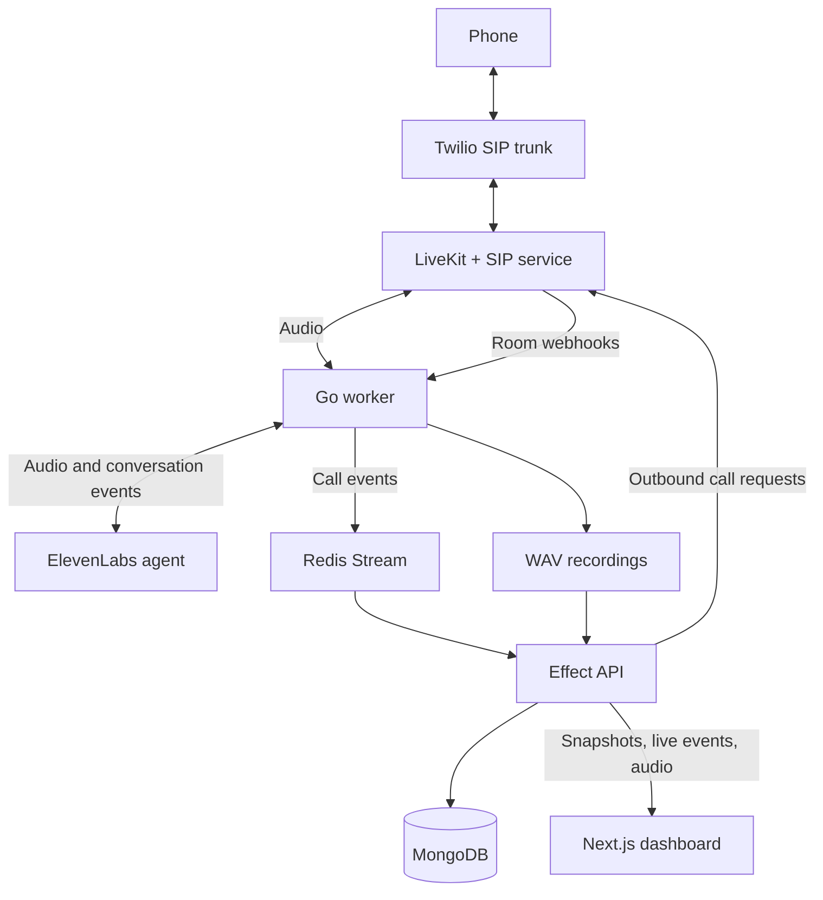

# Ringback

**AI phone calls on your own infrastructure. Bring your own carrier.**

Ringback gives your AI agent a phone line. Connect an ElevenLabs voice agent to a SIP trunk, and it can answer calls, dial out with a task-specific prompt, and press keypad digits to navigate phone menus. Watch the conversation unfold in a live dashboard, then read the transcript or play back the recording.

## Why Ringback?

- **Host the calling stack yourself.** Docker Compose runs LiveKit, the LiveKit SIP service, Redis, MongoDB, the Go worker, the API, and the dashboard on your own Linux host. The media server, event stream, and database are part of the deployment.
- **Bring your own carrier (BYOC).** Native SIP connects your carrier's phone network to LiveKit rooms. The included trunk configuration uses Twilio; adapt the SIP settings for your provider and numbers.
- **Keep application storage on your infrastructure.** Call history and transcripts live in your MongoDB instance. WAV recordings live in a volume shared by the worker and API, ready for playback from the dashboard.
- **Put an agent to work with one API request.** Send a destination and a prompt to `POST /call`, then pay through the returned Stripe Checkout URL. After payment is verified, Ringback dials the number, waits for an answer, starts the agent conversation, and streams its progress to the dashboard.

ElevenLabs provides the hosted voice agent. Ringback runs the calling infrastructure, call orchestration, dashboard, and application storage on your host.

## Features

- **Inbound and outbound calls.** Answer calls through a SIP trunk or purchase an outbound call with `POST /call`.
- **Prompts per call.** Outbound requests set the agent's prompt; inbound calls use the agent's configured prompt.
- **Phone menu navigation.** The agent can press keypad digits through the `send_dtmf` client tool.
- **Live transcripts.** Follow user, agent, and tool turns as they arrive, including transcript corrections.
- **Call history and playback.** Store call metadata and transcripts in MongoDB, with optional stereo WAV recordings.

## How it works



The worker starts a session when LiveKit creates a room whose name begins with `call`. Once the phone participant answers, it bridges the room's audio to an ElevenLabs conversation. Call events flow through the `ringback:calls` Redis Stream to the API, which saves them in MongoDB and sends updates to the dashboard using server-sent events (SSE).

### Repository layout

| Path                         | Purpose                                                                                  |
| ---------------------------- | ---------------------------------------------------------------------------------------- |
| [`apps/worker`](apps/worker) | Go worker: call sessions, audio, agent tools, recordings, and LiveKit webhooks           |
| [`apps/api`](apps/api)       | TypeScript API built with Effect: paid calls, history, transcripts, audio, and SSE       |
| [`apps/web`](apps/web)       | Next.js 16 / React 19 dashboard with SWR and Tailwind CSS                                |
| [`packages`](packages)       | Shared ESLint and TypeScript configuration                                               |
| [`deploy`](deploy)           | LiveKit and SIP configuration, deployment script, Caddy configuration, and host services |

## Local development

### Prerequisites

- Node.js 22, matching the API CI job and application Docker images.
- pnpm 9, pinned to `9.0.0` in `package.json`.
- Docker with Docker Compose for Redis and MongoDB.
- For the voice worker: Go 1.26, a C compiler, `pkg-config`, and the Opus / Opusfile development libraries. Caller speech timing uses Silero, ONNX Runtime, SpeexDSP, and WebRTC Audio Processing.
- For real calls: a reachable LiveKit server and SIP service, a configured SIP provider, an ElevenLabs API key and agent, and a Stripe account for outbound calls.

Install the worker's native dependencies:

```sh
# macOS (with Xcode Command Line Tools installed)
brew install pkg-config opus opusfile speexdsp meson ninja abseil

# Ubuntu / Debian
sudo apt-get update
sudo apt-get install -y build-essential pkg-config libopus-dev libopusfile-dev meson ninja-build libabsl-dev curl ca-certificates
```

### 1. Install dependencies

From the repository root:

```sh
pnpm install --frozen-lockfile
```

### 2. Configure the environment

Create a `.env` file in the repository root. Compose reads it directly; the commands below also load it into the API and worker processes.

```dotenv
LIVEKIT_URL=ws://127.0.0.1:7880
LIVEKIT_API_KEY=replace-with-your-livekit-key
LIVEKIT_API_SECRET=replace-with-your-livekit-secret

ELEVENLABS_API_KEY=replace-with-your-elevenlabs-key
ELEVENLABS_AGENT_ID=replace-with-your-agent-id

REDIS_URL=redis://127.0.0.1:6379
MONGODB_URI=mongodb://127.0.0.1:27017/ringback
CORS_ORIGINS=http://localhost:3000

# Add these to enable outbound calls:
# STRIPE_SANDBOX_API_KEY=replace-with-your-sandbox-secret-key
# STRIPE_SANDBOX_WEBHOOK_SECRET=replace-with-your-listener-signing-secret

# Optional: an existing absolute directory shared by the API and worker.
# AUDIO_DIR=/absolute/path/to/recordings
```

The service-specific examples in [`apps/api/.env.example`](apps/api/.env.example) and [`apps/worker/.env.example`](apps/worker/.env.example) are also available as references.

The API and dashboard can run before you configure real LiveKit or ElevenLabs credentials. The dashboard will be empty until the worker publishes call events.

### 3. Start Redis and MongoDB

```sh
docker compose up -d redis mongo
```

This starts the two data services using the checked-in Compose file. The remaining Compose services are described under [Deployment](#deployment).

### 4. Start the API and dashboard

Run each command block in a separate terminal, starting from the repository root.

**API** — the LiveKit API client uses the HTTP endpoint:

```sh
(
  set -a
  . ./.env
  set +a
  LIVEKIT_URL=http://127.0.0.1:7880 pnpm --filter api dev
)
```

**Dashboard:**

```sh
pnpm --filter web dev
```

Open the `dashboard_url` returned when creating a call. The home page at [localhost:3000](http://localhost:3000) is intentionally blank, white in light system mode and black in dark system mode. Browser requests use `/api` on the same origin; Next.js proxies them to `http://127.0.0.1:3001` locally. Set `RINGBACK_API_UPSTREAM` in `apps/web/.env.local` to change the upstream, and set the API's `RINGBACK_PUBLIC_WEB_URL` to the exact browser origin if using a different host or port.

```sh
curl http://localhost:3001/health
```

### 5. Connect the voice worker

Install the pinned speech dependencies before running the worker locally. Docker includes them. From the repository root, on macOS arm64 or Linux x86_64/arm64:

```sh
speech_prefix="$HOME/.cache/ringback/speech"
(
  cd apps/worker
  if [ "$(uname -s)" = Linux ]; then
    scripts/install-speexdsp.sh "$speech_prefix"
  fi
  scripts/install-webrtc.sh "$speech_prefix"
  scripts/install-onnxruntime.sh "$speech_prefix"
)
export PKG_CONFIG_PATH="$speech_prefix/lib/pkgconfig${PKG_CONFIG_PATH:+:$PKG_CONFIG_PATH}"
if [ "$(uname -s)" = Darwin ]; then
  export ONNXRUNTIME_SHARED_LIBRARY_PATH="$speech_prefix/lib/libonnxruntime.dylib"
else
  export LD_LIBRARY_PATH="$speech_prefix/lib${LD_LIBRARY_PATH:+:$LD_LIBRARY_PATH}"
  export ONNXRUNTIME_SHARED_LIBRARY_PATH="$speech_prefix/lib/libonnxruntime.so"
fi
```

Keep these exports in the terminal used to run the worker and its tests. Missing ONNX Runtime disables caller timestamps and logs a warning; call audio and transcript text continue. Restart the worker after fixing the library path.

Before starting the worker, configure the services it connects to:

1. **LiveKit:** use matching API credentials and send room webhooks to the worker's `POST /livekit` endpoint. Locally, that is `http://127.0.0.1:8080/livekit`; a remote LiveKit server needs an address it can reach. Set `webhook.api_key` in [`deploy/config/livekit.yaml`](deploy/config/livekit.yaml) to your LiveKit key.
2. **SIP:** configure your provider and LiveKit trunks. The files in [`deploy/sip`](deploy/sip) contain the current Twilio setup; replace the phone numbers and trunk address for your environment. Keep the outbound trunk name `twilio-outbound`, which the API looks up by name. Inbound dispatch must create rooms beginning with `call`.
3. **ElevenLabs:** configure the agent's input and output audio as `pcm_48000`. The worker checks both formats when connecting. Allow prompt overrides for outbound calls. For keypad navigation, configure a client tool named `send_dtmf` with a required string parameter named `digits` and a tool response.

With valid credentials and a reachable LiveKit WebSocket URL in `.env`, start the worker in another terminal:

```sh
(
  set -a
  . ./.env
  set +a
  cd apps/worker
  go run .
)
```

```sh
curl http://127.0.0.1:8080/healthz
```

The worker listens on `127.0.0.1:8080` by default. Set `WORKER_HTTP_ADDR` if it needs to listen on another interface. For a remote LiveKit server, also update the HTTP URL in the API startup command.

### Configuration reference

| Variable                                                        | Used by     | Default / behavior                                                                                  |
| --------------------------------------------------------------- | ----------- | --------------------------------------------------------------------------------------------------- |
| `LIVEKIT_URL`                                                   | Worker, API | Required WebSocket URL for the worker; API defaults to `http://127.0.0.1:7880`                      |
| `LIVEKIT_API_KEY`, `LIVEKIT_API_SECRET`                         | Worker, API | Required for worker sessions and outbound dialing                                                   |
| `ELEVENLABS_API_KEY`, `ELEVENLABS_AGENT_ID`                     | Worker      | Required                                                                                            |
| `REDIS_URL`                                                     | Worker, API | API defaults to `redis://127.0.0.1:6379`; worker publishes no events when unset                     |
| `MONGODB_URI`                                                   | API         | `mongodb://127.0.0.1:27017/ringback`                                                                |
| `RINGBACK_CALLS_KEEPALIVE_MS`                                   | API         | SSE keepalive interval in milliseconds; defaults to `15000`                                         |
| `RINGBACK_CALLS_RETRY_MS`                                       | API         | SSE reconnect delay in milliseconds; defaults to `3000`                                             |
| `NODE_ENV`                                                      | API         | `development` uses Stripe Sandbox and `production` uses live Stripe; defaults to `development`      |
| `STRIPE_SANDBOX_API_KEY`, `STRIPE_SANDBOX_WEBHOOK_SECRET`       | API         | Required for outbound calls in development                                                          |
| `STRIPE_PRODUCTION_API_KEY`, `STRIPE_PRODUCTION_WEBHOOK_SECRET` | API         | Required for outbound calls in production                                                           |
| `RINGBACK_CALL_PRICE_CENTS`, `RINGBACK_CALL_CURRENCY`           | API         | Price of one call; defaults to `50` and `usd`                                                       |
| `RINGBACK_PUBLIC_API_URL`, `RINGBACK_PUBLIC_WEB_URL`            | API         | Public addresses used in call links; default to `http://localhost:3001` and `http://localhost:3000` |
| `RINGBACK_REQUIRE_TERMS`                                        | API         | Require accepting your terms in Checkout; defaults to `false`                                       |
| `AUDIO_DIR`                                                     | Worker, API | Unset disables recording and audio serving; both services must access the same files                |
| `WORKER_HTTP_ADDR`                                              | Worker      | `127.0.0.1:8080`                                                                                    |
| `PORT`                                                          | API         | `3001`                                                                                              |
| `CORS_ORIGINS`                                                  | API         | `http://localhost:3000`; accepts comma-separated origins                                            |
| `RINGBACK_API_UPSTREAM`                                         | Dashboard   | Local `/api` proxy target; defaults to `http://127.0.0.1:3001`; resolved during development/build |

The API checks its settings at startup and refuses to start when one is invalid.

## Using the API

The local API base URL is `http://localhost:3001`. The checked-in Caddy configuration exposes these routes under `/api` in deployment.

| Method | Route                | Description                                                      |
| ------ | -------------------- | ---------------------------------------------------------------- |
| `GET`  | `/health`            | API health response                                              |
| `POST` | `/call`              | Request an outbound call and get its Stripe Checkout link        |
| `GET`  | `/call/:id`          | Authorized task, payment/dispatch state, call metadata, and access expiry |
| `POST` | `/call/:id/access`   | Browser bootstrap: bearer token and trusted Origin establish an HttpOnly cookie |
| `GET`  | `/call/:id/turns`    | Authorized transcript ordered by turn sequence |
| `GET`  | `/call/:id/audio`    | Authorized WAV recording, including byte-range playback |
| `GET`  | `/call/:id/events`   | Authorized live and replayed events for this call |
| `POST` | `/webhooks/stripe`   | Signed Stripe payment events                                     |

Errors respond with `{ "error": "<code>" }`, where the code is `invalid_request`, `unauthorized`, `not_found`, `conflict`, `prompt_not_allowed`, `unavailable`, or `internal`.

### Place a call

Outbound calls are paid through Stripe Checkout, and they need the LiveKit, SIP, and worker setup above. In development the API uses your [Stripe Sandbox](https://docs.stripe.com/sandboxes) keys, so you can pay with the test card `4242 4242 4242 4242`. With `NODE_ENV=production` it takes live payments. Either way, a paid call is a real phone call.

Add your Sandbox API key to `.env`, then forward Stripe's events to the API with the [Stripe CLI](https://docs.stripe.com/stripe-cli):

```sh
(
  set -a
  . ./.env
  set +a
  stripe listen --api-key "$STRIPE_SANDBOX_API_KEY" --forward-to http://localhost:3001/webhooks/stripe
)
```

Copy the signing secret it prints into `STRIPE_SANDBOX_WEBHOOK_SECRET` and restart the API. Then request a call, replacing the example number with the intended recipient's number:

```sh
curl -X POST http://localhost:3001/call \
  -H 'Content-Type: application/json' \
  -H 'Idempotency-Key: confirm-appointment-1' \
  -d '{
    "to": "+15551234567",
    "prompt": "You are calling to confirm the appointment time. Keep the conversation brief."
  }'
```

The destination must use E.164 format. The prompt must contain 1–16,000 characters after trimming, and prompts asking for prank calls, harassment, impersonation, robocalls, or threats are refused. A successful request returns `201`:

```json
{
  "call_id": "3f9c…",
  "status": "unpaid",
  "checkout_url": "https://checkout.stripe.com/…",
  "access_token": "<43-character base64url secret>",
  "access_expires_at": "2026-11-08T12:00:00.000Z",
  "status_url": "http://localhost:3001/call/3f9c…",
  "dashboard_url": "http://localhost:3000/call/3f9c…#token=<access_token>",
  "amount": 50,
  "currency": "usd",
  "max_duration_seconds": 1800
}
```

Open `checkout_url` to pay. Every call can last up to 30 minutes. Once Stripe confirms the payment, Ringback dials the number, and the call status moves from `unpaid` to `paid`, `dialing`, and `dialed`. A checkout nobody pays within 35 minutes ends in `expired`. A call that fails to dial ends in `failed` and is never redialed, since it may have gone through.

Save the access token and use it to read `status_url`:

```sh
curl http://localhost:3001/call/<call_id> \
  -H 'Authorization: Bearer <access_token>'
```

One token grants read access to all results for its call: status, metadata, transcript, recording, and live events. Its hash, expiry, and revocation state are stored with the request; the raw token is never stored server-side. Access lasts 30 days from creation, independently of Checkout's expiry. Missing or malformed bearer credentials return `401`; an unknown call, incorrect token, expired token, or revoked token returns `404`. Calls created before this access model have no token and cannot be read through `GET /call/:id`.

`dashboard_url` opens the private page at `/call/:id`. The browser removes the token fragment from the address bar and submits the token in an Authorization header to `POST /api/call/:id/access`. The API verifies the token and browser Origin, then sets an HttpOnly, SameSite=Lax cookie scoped to `/api/call/:id`, with Secure enabled in production. Cookies expire with the original grant; every read still checks its expiry and revocation. The browser never puts the token in localStorage or query strings.

Open the private dashboard first and use its **Continue to payment** link so browser access is established before Checkout. Stripe returns to the secret-free call URL, where the cookie restores access. If payment was opened directly, or a different browser is used, reopen the original private link. Without valid access, the page shows a small centered lock icon and no call details.

The debugging dashboard uses a compact monospace layout with JSON call/request metadata, the prompt, live transcript, and native recording playback with transcript seeking. The API keeps dispatch `status` separate from the nested `call.status` (`active` or `ended`); `dialed` does not imply completion. Billing/contact snapshots and provider identifiers stay server-side. Private data uses `Cache-Control: no-store`, with noindex and no-referrer protections on private pages. Expiry or revocation stops later reads; open feeds recheck access before each event and during idle keepalives, at most 15 seconds apart. Recordings and transcripts retain the existing deployment's storage lifecycle; token expiry does not delete them.

The old `/calls`, `/calls/events`, and room-based transcript/audio routes return `404`, including when a call token is supplied. Global history and operational access are not exposed by these public routes. Private call pages live under `apps/web/app/(app)`; the blank homepage lives in the sibling `(website)` group, outside the app theme and data providers.

### Creation retries and lost responses

Call IDs are random and independent of `Idempotency-Key`. Keyed requests store an optional `retry` object containing `keyHash` and, when a recovery secret is supplied, `recovery`. Requests without an idempotency key have no `retry` object. Retrying an existing keyed request requires the original body and either its bearer access token or the original `Idempotency-Secret`. A key or matching body alone returns `409` and never reveals or changes credentials. Authorized retries preserve the request, approved quote, token, and Checkout Session, including under concurrent requests. An access token cannot authorize creation of another call.

For recovery when the first response is lost, generate and save a separate 32-byte random recovery secret before sending the request. Encode it as unpadded base64url (43 characters), and send it alongside the key:

```sh
curl -X POST http://localhost:3001/call \
  -H 'Content-Type: application/json' \
  -H 'Idempotency-Key: confirm-appointment-1' \
  -H 'Idempotency-Secret: <saved-43-character-random-secret>' \
  -d '{"to":"+15551234567","prompt":"Confirm the appointment time."}'
```

Retry with the same key, secret, and body after a network failure. The server uses HMAC-SHA256 over a fresh 32-byte salt to derive the call token from that secret. Only a recovery-secret hash and public salt are stored, so an authorized retry can reconstruct the same token without persisting it. The recovery secret authorizes creation retries only and cannot be used for call reads; it is specific to this request and introduces no account or persistent API key. Keep both secrets out of logs and analytics. Expiry or revocation invalidates recovery as well as bearer access.

Without a recovery secret supplied on the initial request, a lost response or lost token cannot be recovered with the key alone. Keep the same key when checking an uncertain outcome; do not automatically switch keys, which would create another call request. A retry cannot add a recovery secret to an existing request. Legacy keyed requests likewise return `409` rather than gaining newly minted access or creating another Checkout Session.

### Follow live events

```sh
curl -N http://localhost:3001/call/<call_id>/events \
  -H 'Authorization: Bearer <access_token>'
```

The feed supports `Last-Event-ID` to replay missed events still retained in Redis. Both replay and live updates include only the authorized call. A `ready` event indicates that the live subscription is attached; clients should refresh snapshots then, including after reconnects, to reconcile events missed before subscription or no longer retained in Redis. Timestamps use Unix milliseconds. Transcript roles are `user`, `agent`, and `tool`; a repeated `(room, seq)` updates an existing turn. The private `call.ended` event reports `audio_available` instead of a filesystem name. An `access.unavailable` event ends the feed when the server can no longer authorize access.

Only verified payment can make a request eligible to dial. The read token grants access to one call's results and does not grant operational controls.

## Development commands

Run these from the repository root:

```sh
pnpm build                    # Build the API and dashboard
pnpm lint                     # Lint the TypeScript apps and shared packages
pnpm --filter api check-types
pnpm --filter web typecheck
pnpm test                     # Run the API's Vitest suite
pnpm --filter web exec playwright install chromium
pnpm --filter web test:e2e     # Browser access, Checkout return, playback, and isolation
```

The API's MongoDB tests run when `MONGODB_URI` is set. They create and drop their own `ringback_test_*` databases:

```sh
MONGODB_URI=mongodb://127.0.0.1:27017 pnpm --filter api test
```

Run worker checks separately:

```sh
cd apps/worker
go vet ./...
go test -race ./...
go build ./...
```

Caller speech detection lives in `internal/speech`, with each Go implementation paired with its test file: `echo` removes playback echo, `silero` classifies speech, `detector` groups timestamps, and `analyzer` runs analysis outside recording. The package owns its `models` and `testdata` directories, including attribution. `internal/audio` provides PCM helpers, Opus, DTMF, and playback buffering.

For recording load checks, run `go test ./internal/room -run '^$' -bench BenchmarkTapConcurrentSpeech -benchtime=1x`. The optional `TestLiveSpeechInterruption` in `internal/session/timing_test.go` runs against a local LiveKit development server when `VAD_LIVEKIT_URL` is set (development credentials: `devkey` / `secret`).

`pnpm dev` starts the API and dashboard through Turborepo. The Go worker is managed separately. For custom API environment values, use the explicit environment-loading command above. The root `pnpm check-types` command runs the API check; the web package uses a separate `typecheck` script.

## Deployment

The calling stack runs on your own Linux host. [`docker-compose.yml`](docker-compose.yml) includes the LiveKit media server and SIP service alongside Redis, MongoDB, the worker, the API, and the dashboard. You supply the host, SIP carrier configuration, and ElevenLabs credentials.

Compose pulls application images from `ghcr.io/ayukumar261` and uses host networking for LiveKit, SIP, and the worker. Redis, MongoDB, and call recordings use persistent Docker volumes.

The current deployment flow is:

1. [GitHub Actions](.github/workflows/deploy.yml) builds and pushes all three application images on pushes to `main`, then sends a signed request to the deployment webhook.
2. [`deploy/deploy.sh`](deploy/deploy.sh) runs from `/opt/ringback`, resets that checkout to `origin/main`, pulls images, and starts the Compose services.
3. The script creates or updates LiveKit SIP trunks and the dispatch rule, applies the SIP firewall rules, and reloads Caddy.

To adapt this deployment, configure the root `.env`, image names, domain in [`deploy/host/Caddyfile`](deploy/host/Caddyfile), LiveKit webhook key, and SIP settings. The host scripts expect Docker Compose, the `lk` CLI, `jq`, `iptables`, Caddy, and systemd; the deployment hook service also uses the `webhook` binary. GitHub Actions expects `RINGBACK_HOOK_URL` and `RINGBACK_HOOK_SECRET`, with the same hook secret installed on the host as described in [`deploy/host/hook.env.example`](deploy/host/hook.env.example).

The browser uses same-origin `/api` routes, which Caddy forwards to the API in deployment. Keep this path when adapting the proxy so call-scoped cookies work for status, audio, and SSE. Compose shares an `audio-data` volume between the worker and API and stores Redis and MongoDB data in named volumes.

The API image runs with `NODE_ENV=production`, so it takes live payments. Add a Stripe webhook endpoint for `https://<your domain>/api/webhooks/stripe`, put its signing secret and your live key in `.env` as `STRIPE_PRODUCTION_WEBHOOK_SECRET` and `STRIPE_PRODUCTION_API_KEY`, and set `RINGBACK_PUBLIC_API_URL` and `RINGBACK_PUBLIC_WEB_URL` to your public addresses.

## Troubleshooting

| Symptom                                     | Check                                                                                                                       |
| ------------------------------------------- | --------------------------------------------------------------------------------------------------------------------------- |
| Private dashboard is locked                | Reopen the original private link; check token expiry/revocation and the API's `RINGBACK_PUBLIC_WEB_URL` origin. |
| Worker exits with a missing-variable error  | Load `.env` into the process environment; the worker does not load it automatically.                                        |
| `POST /call` returns `503`                  | Check the Stripe keys for your `NODE_ENV`, and that LiveKit is reachable with the `twilio-outbound` trunk.                  |
| ElevenLabs reports an audio format mismatch | Set both agent audio formats to `pcm_48000`.                                                                                |
| Recordings are unavailable                  | Set `AUDIO_DIR` for both services, ensure the worker can write there and the API can read it, and wait for the call to end. |
| Browser cannot reach the API                | Check same-origin `/api` routing, `RINGBACK_API_UPSTREAM` locally, and Caddy's API upstream in deployment. |
